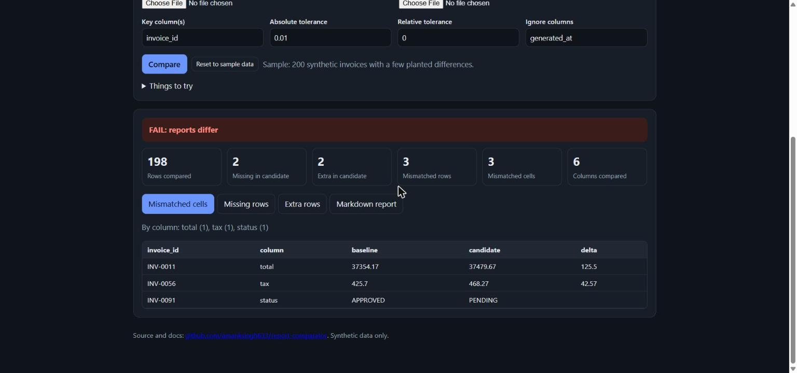

# Report Comparator

[](https://github.com/amanksingh633/report-comparator/actions/workflows/ci.yml)


**[Try the live demo](https://amanksingh633.github.io/report-comparator/)**: runs in your browser, nothing to
install, nothing uploaded.

[](https://amanksingh633.github.io/report-comparator/)

Diff two CSV or Excel reports by key and see exactly what changed: missing rows, extra rows,
schema changes, and every mismatched cell, with numeric tolerances. Use it from the command line
as a **release gate** (non-zero exit code on any difference) or in a small **Streamlit** UI.

## Why this exists

After a config or code change, "did the report output change?" is usually answered by eyeballing
two spreadsheets or writing a one-off VLOOKUP. That is slow and misses things. This tool does the
comparison the same way every time, explains each difference, and fails loudly when the outputs
diverge.

> Independent, generic implementation built on synthetic data. It contains no employer code,
> customer data, or real report layouts.

## Product notes

How I would frame this as a product, and the decisions behind it. These are design rationale and
hypotheses; nothing here is a measured result.

- **Problem.** After a configuration or code change, "did the report output change?" is usually
  answered by eyeballing two spreadsheets. That is slow, inconsistent between reviewers, and easy
  to get wrong under release pressure.
- **Users.** The person signing off a release (implementation, operations or QA) and the
  reviewer who must trust that sign-off.
- **Decisions and trade-offs.**
  - *Match on keys, not row order*: reports are re-sorted between runs, so row position means
    nothing. The cost is that duplicate keys must be rejected loudly.
  - *Explicit tolerances*: float noise should not fail a release, but real differences must.
    Choosing the tolerance is a business policy, so the default is zero and it is set per run.
  - *Volatile columns are ignored only by name*, so silence is always a visible decision.
  - *Schema changes fail the gate*: stricter than a lenient diff, because a silently added or
    dropped column is exactly what a reviewer needs to see.
  - *Exit codes and a browser demo*: the CLI makes it a release gate; the in-browser demo lets a
    non-technical reviewer try it with nothing uploaded.
- **How I would measure it.** Time to validate a release versus the manual method; defects found
  after release; false alarms (differences a reviewer dismissed); how often it is run per release.
- **Next.** Saved comparison profiles per report, multi-sheet Excel, and a reviewer sign-off note
  attached to each run.
- **Known gaps.** Validated only on synthetic data here; no pilot, so no outcome data.

## Live demo

The demo page loads the real `report_comparator` package and pandas into your browser with
[Pyodide](https://pyodide.org) (WebAssembly), so there is no server and your data never leaves
the page. It opens with the bundled synthetic invoices; paste or load your own CSVs to try it.
The files under `docs/` are copies of `src/` kept in sync by `scripts/sync_demo.py` and checked
by a test.

## Quick start

```bash
git clone https://github.com/amanksingh633/report-comparator
cd report-comparator
pip install -e ".[app]"

# Command line (exit code 0 = match, 1 = differ, 2 = bad input)
report-comparator sample_data/baseline.csv sample_data/candidate.csv \
    -k invoice_id -i generated_at --abs-tol 0.01

# Web UI (tick "Use built-in sample data" in the sidebar for an instant demo)
streamlit run app.py
```

Example output on the bundled synthetic invoices (200 rows each, a handful of deliberate
differences):

```text
# Report comparison: FAIL: reports differ

| Metric | Value |
|---|---|
| Key columns | invoice_id |
| Rows in baseline / candidate | 200 / 200 |
| Rows compared | 198 |
| Missing in candidate | 2 |
| Extra in candidate | 2 |
| Mismatched rows / cells | 3 / 3 |

## Mismatched cells

| invoice_id | column | baseline | candidate | delta |
|---|---|---|---|---|
| INV-0011 | total | 37354.17 | 37479.67 | 125.5 |
| INV-0056 | tax | 425.7 | 468.27 | 42.57 |
| INV-0091 | status | APPROVED | PENDING |  |
```

Float noise (`+0.004` on three rows), a timestamp column that always changes, and trailing
whitespace were all handled by `--abs-tol 0.01`, `-i generated_at`, and default string stripping,
so only real differences are reported.

## Features

- **Key-based matching**: single or composite keys (`-k region -k month`); duplicate keys are
  rejected with a clear error rather than silently mis-joined.
- **Tolerances**: absolute (`--abs-tol`) and relative (`--rel-tol`), applied per numeric cell.
- **Sensible equality**: null equals null, null vs value is a mismatch, numeric strings compare
  as numbers (`"10.0"` equals `10`), surrounding whitespace is ignored unless disabled.
- **Schema awareness**: columns present on only one side are reported and fail the gate.
- **Ignore columns**: skip volatile fields such as generation timestamps.
- **Outputs**: Markdown summary (`-o report.md`) for PRs and release notes, plus CSV download of
  mismatches in the UI.
- **CI-friendly**: meaningful exit codes (0 match, 1 differ, 2 bad input). The project's own CI runs lint and tests on Python 3.10 and 3.12.

## Use as a library

```python
from report_comparator import compare_reports, load_report, render_markdown

result = compare_reports(
    load_report("before.xlsx"),
    load_report("after.xlsx"),
    keys=["invoice_id"],
    abs_tol=0.01,
    ignore_columns=["generated_at"],
)
print(result.passed, result.mismatched_cells)
print(render_markdown(result))
```

## Project layout

```text
src/report_comparator/   compare.py (core), render.py (Markdown), cli.py
app.py                   Streamlit UI
docs/                    GitHub Pages live demo (Pyodide) + screenshot
scripts/sync_demo.py     copies the package and sample data into docs/
sample_data/             synthetic baseline/candidate + generator script
tests/                   22 tests: comparison rules, CLI exit codes, UI and demo checks
```

## Development

```bash
pip install -e ".[dev]"
ruff check . && pytest
```

## Notes

Built with AI assistance (Claude). The test suite pins the behaviour described above.

## License

MIT
